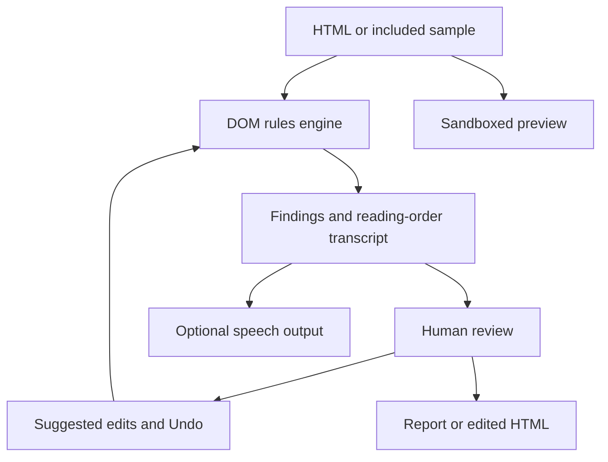

# Fathom

**See it. Hear it. Fix it.**


Fathom is an interactive HTML accessibility workbench built for [Technica 2026](https://technica-2026.devpost.com/). Paste HTML or choose an included sample, inspect barriers, compare visual simulations, listen to a DOM-based reading-order transcript, and review suggested fixes with Undo.

[Open the application](https://fathom-a11y.vercel.app) · [Watch the demo](https://fathom-demo-alpha.vercel.app) · [Run locally](#run-locally)

## Explore

| Capability | What you can inspect |
|---|---|
| Visual lenses | Color-vision, low-vision, glare, and tunnel-vision approximations |
| Keyboard view | Tab order and clickable elements that lack keyboard access |
| Listen | Reading order inferred from DOM semantics, with optional speech |
| Audit and repair | WCAG-related rules, explanations, suggested fixes, and re-auditing |
| Content checks | Inclusive-language suggestions and Flesch–Kincaid readability |
| Export | Markdown findings and edited HTML |

The clarity score summarizes findings detected by this engine. It does not certify WCAG conformance. Visual and reading-order simulations are educational approximations, not a substitute for testing with assistive technology and people.

## Run locally

Use Node.js and npm.

```sh
git clone https://github.com/adeelfalaksher900-creator/fathom-a11y.git
cd fathom-a11y
npm install
npm run build
npm start
```

Open `http://localhost:4173`. The build copies self-hosted fonts and attempts to obtain optional pre-rendered speech clips. The app can fall back to browser speech when clips or live voice are unavailable. No private API key is required for local auditing.

| Command | Purpose |
|---|---|
| `npm run build` | Prepare fonts and available speech clips |
| `npm start` | Serve `public/` with the local Node server |
| `npm test` | Run the Playwright-based browser harness |

The current test harness imports Playwright from `/opt/npm-tools/node_modules/playwright/index.mjs`. It requires that environment-specific installation and a running application; installing this package's declared dependencies alone does not provide it. The harness source covers functional flows, hostile HTML, keyboard and ARIA behavior, viewport sizes, motion preferences, and axe-core checks. No fresh passing test result is claimed by this documentation update.

## Architecture



`public/engine.js` performs DOM-based analysis. `public/app.js` drives the interface, preview, re-auditing, and export. The static app uses native ES modules. Preview layouts use the selected device width before scaling to the available panel.

## Privacy

HTML auditing runs in the browser. The preview uses a sandboxed iframe with `allow-same-origin`; scripts and inline handlers are neutralized for preview, and preview links and forms are blocked. Remote image, font, stylesheet, or media URLs in supplied HTML can still contact their hosts. Review exported HTML before using it elsewhere, because the export preserves source content.

Browser speech may use an operating-system service. Optional live speech sends up to 1,400 transcript characters to a configured ElevenLabs proxy. Use permitted content and avoid confidential HTML when enabling external speech.

## Deployment

The included Vercel configuration serves the static application with response headers. For optional live speech, configure `ELEVENLABS_API_KEY` and optionally `ELEVENLABS_VOICE_ID` as server environment variables. `api/voice.js` provides the proxy; the local static server provides a stub rather than the live service.

The proxy's limit is instance-local, not a durable public quota. Add appropriate authentication, quotas, and cost controls before exposing a paid speech key to unrestricted use.

## Project map

| Path | Responsibility |
|---|---|
| `public/engine.js` | DOM rules and suggested repairs |
| `public/app.js` | Interface and application state |
| `public/samples.js` | Included educational examples |
| `public/index.html`, `public/app.css` | Page structure and styles |
| `api/voice.js` | Optional serverless speech proxy |
| `scripts/` | Font and speech-asset preparation |
| `tests/run.mjs` | Browser verification harness |
| `video/` | Recorded-app composition and video build source |

## Review and contribute

Suggested alternative text, labels, table headers, language changes, and other repairs can change meaning. Review them, use Undo when needed, and test the resulting page with real assistive technology.

Submit focused pull requests with the affected rule or workflow, reproduction steps, and validation performed. Do not include confidential source HTML, private keys, or personal records.

## Attribution

The project was developed under the author's direction with AI assistance in implementation, testing, documentation, and presentation. The existing presentation uses generated ElevenLabs speech and a HyperFrames composition of application recordings. The Listen view remains a DOM-based simulation rather than NVDA or VoiceOver.

## License

Project source is [MIT licensed](LICENSE). Third-party packages, fonts, and services retain their own terms.
